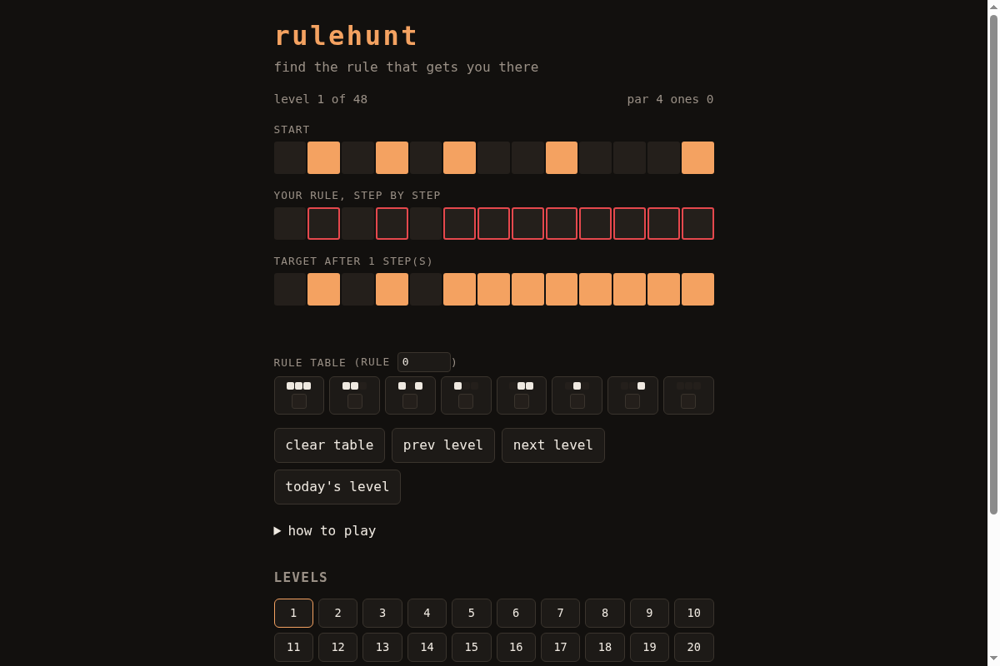

# rulehunt

A cellular automaton puzzle. You see a start row and the row the automaton must
reach after a few steps. Set the 8-entry rule table so it lands on the target.

**Play:** https://therealalexxx.github.io/rulehunt/


The rows wrap around. A cell looks at (left, centre, right) and the table says
what it becomes, the same scheme as Wolfram's elementary rules, so the table is
also a rule number from 0 to 255. Early levels need one step, which you can read
off directly. Later ones need up to six, where you have to reason about what the
table must do or hill-climb on the red mismatch cells.

Open https://therealalexxx.github.io/rulehunt/#daily for the level of the day (same for everyone per UTC date). Solving it offers a copy-able result line.

Score is the number of 1s in your table. Par is the smallest table that works.
Winning shows how many rules solve the level: some have exactly one, a few have
several.

## How levels are made

`gen.js` picks a random start row and a hidden rule, runs it, and keeps the
level only if the target is not nearly empty or full and the smallest working
table has at least 3 ones. Then `ca.js` tries all 256 rules to record how many
solve it and what par is. Levels are ordered by steps, then by how many rules
work.

```
node gen.js <seed> <count>
```

## Tests

```
node --test test.js test-daily.js
```

Checks rule 90 and rule 30 against known rows, the wrap-around, a brute-force
search recovering known rules, and that every shipped level's stored example,
match count and par are right.

## License

MIT
